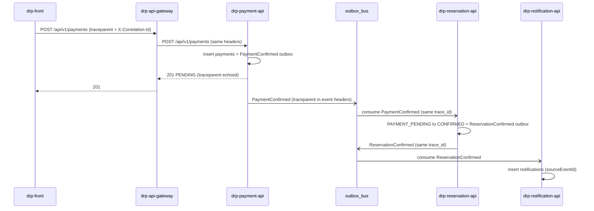

# CP1 — Critical journey and trace map

Journey: **Start a SpaceHub payment and confirm the reservation**.

Sources in `drp-docs`: E-16 (`POST /api/v1/payments`), D-C14 (no HTTP confirm),
D-C16 (`X-Correlation-Id` = `traceId`), event catalog `PaymentConfirmed` /
`ReservationConfirmed`, tables `payment.payments`, `payment.outbox`,
`reservation.reservations`, `reservation.outbox`, Mongo collection `notifications`.

The client already created a `PAYMENT_PENDING` row with E-12. This journey is the
pay-and-confirm path. `drp-reservation-api` never calls `drp-payment-api` over
HTTP (E-12). Confirmation is the consume of `PaymentConfirmed`.

Today the product carries `X-Correlation-Id` (uuid). This workshop also carries
W3C `traceparent`. Same `trace_id` in both; `correlation_id` stays the uuid.

## Hop table

| Step | Caller | Callee | Protocol | Operation | Sync/Async | Data |
| --- | --- | --- | --- | --- | --- | --- |
| 1 | `drp-front` | `drp-api-gateway` | HTTPS REST | `POST /api/v1/payments` | sync | none (JWT, `Idempotency-Key`) |
| 2 | `drp-api-gateway` | `drp-payment-api` | HTTP REST | `POST /api/v1/payments` | sync | `payment.payments`, `payment.outbox` |
| 3 | `drp-payment-api` | outbox publisher | event | publish `PaymentConfirmed` | async | `payment.outbox` |
| 4 | outbox / bus | `drp-reservation-api` | event | consume `PaymentConfirmed` | async | `reservation.reservations`, `reservation.outbox` |
| 5 | `drp-reservation-api` | outbox publisher | event | publish `ReservationConfirmed` | async | `reservation.outbox` |
| 6 | outbox / bus | `drp-notification-api` | event | consume `ReservationConfirmed` | async | Mongo `notifications` |

Hop 2 is the downstream HTTP dependency used later in the incident drill.
Hop 4 is the asynchronous boundary: same `trace_id`, new `span_id`.

## Sequence

## Span tree

One `trace_id` for the whole pay-and-confirm path.

- `front.startPayment` (root)
  - `gateway.proxyPayments` (child, HTTP)
    - `payment.createAttempt` (child, HTTP hop 2)
      - `payment.writeOutbox` (child, SQL)
      - `payment.publishPaymentConfirmed` (child, **async boundary**)
        - `reservation.onPaymentConfirmed` (child, hop 4)
          - `reservation.updateToConfirmed` (child, SQL)
          - `reservation.publishReservationConfirmed` (child, async)
            - `notification.onReservationConfirmed` (child, hop 6)
