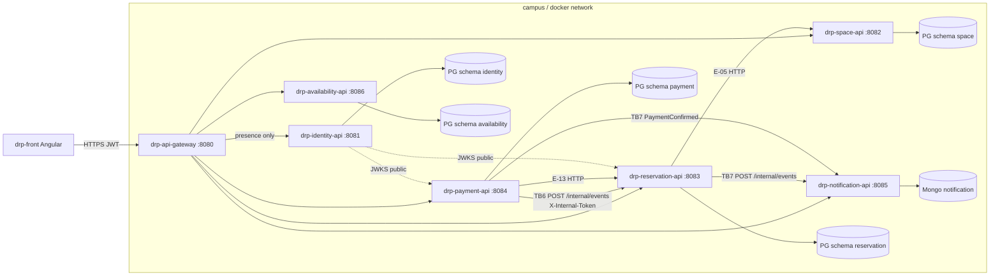

# Attack surface — SpaceHub DRP

Sources: `drp-docs/03-product`, `05-architecture`, `07-api/api-contract.md`,
`09-microservices/service-catalog.md`. **My boundary is TB6** (bold in the diagram).

## Data flow

| Id | Trust boundary | From → to |
| --- | --- | --- |
| TB1 | Internet → gateway | browser → `drp-api-gateway` |
| TB2 | Gateway → identity | `:8080` → `drp-identity-api` |
| TB3 | Gateway → reservation | `:8080` → `GET/POST /api/v1/reservations` |
| TB4 | Reservation → PG | `drp-reservation-api` → schema `reservation` |
| TB5 | Payment → PG | `drp-payment-api` → schema `payment` |
| **TB6** | **Payment → reservation (mine)** | **`POST /internal/events` on :8083** |
| TB7 | Domain → notification | outbox → `drp-notification-api` :8085 |

TB6 is not on the gateway. Today the token is the shared env
`INTERNAL_EVENT_TOKEN` (`spacehub-dev-internal` in `.env.example`). AMQP
replaces this hop later (`07-api` E-23).

## Asset inventory

| Asset | Where it lives | Class |
| --- | --- | --- |
| JWT (`sub`, `role`, `exp`) | `drp-identity-api`, `Authorization` header | confidential |
| Reservation (`userId`, `spaceId`, period, state) | schema `reservation`, E-11 body | confidential |
| `amountCents` + `reservationId` | `drp-payment-api`, E-16 body | restricted |
| `PaymentConfirmed` payload (`paymentId`, `userId`) | payment outbox, then TB6 body | confidential |
| `INTERNAL_EVENT_TOKEN` | env of payment and reservation | restricted |
| Notification `sourceEventId` | Mongo `notifications` | confidential |
| JWKS (`n`, `e`, `kid`) | `GET /api/v1/auth/jwks` | public |
| Space `name` / `active` | schema `space`, E-05 | internal |

## Entry points on TB6

| Entry | Who calls it | Auth today |
| --- | --- | --- |
| `POST /internal/events` `:8083` | `drp-payment-api` OutboxRelay after E-16 | `X-Internal-Token`; 401 if missing; 503 if unset |
| Body `eventType=PaymentConfirmed` | same | payload `reservationId`, `amountCents`, `userId` |
| Body `eventType=PaymentFailed` | same | E-23: state stays `PAYMENT_PENDING` |
| Duplicate `eventId` | retry of the relay | in-memory inbox, no second confirm |

Not an entry: `POST /api/v1/reservations/{id}/confirm` — that route is 404 (D-C14).
