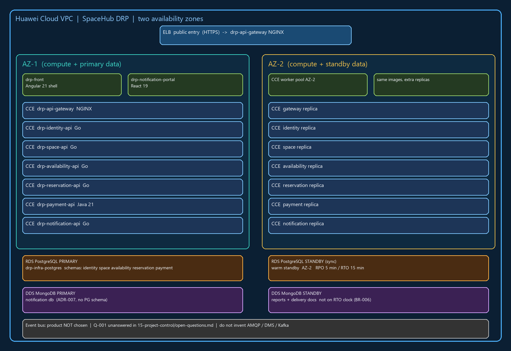

# Architecture design note — SpaceHub

This note redesigns **DRP for SpaceHub** (coworking / business centers) onto Huawei Cloud. It starts from the published `-docs` in `05-architecture` and `06-data`, as corrected by Anexo J and [ADR-006](https://github.com/code-corhuila/drp-docs/blob/main/05-architecture/decisions/records/ADR-006-instructor-anexo-j.md). Older C4 drawings in `05-architecture/overview.md` still show one PostgreSQL container per service and Go on payment; those drawings are **not** the target. Isolation is **schema + `*_app` user** on one engine per environment, not five engines. `notification` has **no** PostgreSQL schema. Q-001 (production broker) is unanswered, so this note does not pick RabbitMQ, Kafka or Huawei DMS as a fact.

## 1. Target architecture

The diagram places every GitHub service from `09-microservices/service-catalog.md` on a Huawei Cloud component, split across **AZ-1** and **AZ-2** in one VPC. Public HTTPS stops at Elastic Load Balance. Stateless APIs run as containers on Cloud Container Engine in both zones. Relational data sits on **one** RDS for PostgreSQL instance per environment (`drp-infra-postgres`), with a synchronous standby in the second AZ. Document data sits on Document Database Service (MongoDB-compatible) for `notification` only. The event hop that `09-microservices/service-catalog.md` still draws as “worker/broker” is a **box labeled Q-001**, not a product we invented.

| Component in the diagram | Defined in (file of your team's -docs) |
|---|---|
| `drp-front` (Angular 21 shell) | `05-architecture/deployment.md` |
| `drp-notification-portal` (React 19) | `05-architecture/decisions/records/ADR-006-instructor-anexo-j.md` |
| `drp-api-gateway` (NGINX) | `09-microservices/services/01-api-gateway/README.md` |
| `drp-identity-api` (Go) + schema `identity` | `09-microservices/services/02-identity-service/README.md`, `06-data/models.md` |
| `drp-space-api` (Go) + schema `space` | `09-microservices/services/03-space-service/README.md`, `06-data/models.md` |
| `drp-availability-api` (Go) + schema `availability` | `09-microservices/service-catalog.md`, `06-data/models.md` |
| `drp-reservation-api` (Go) + schema `reservation` | `09-microservices/services/04-reservation-service/README.md`, `06-data/models.md` |
| `drp-payment-api` (Java 21) + schema `payment` | `05-architecture/decisions/records/ADR-006-instructor-anexo-j.md`, `06-data/models.md` |
| `drp-notification-api` (Go) + MongoDB `notification` | `05-architecture/decisions/records/ADR-007-mongodb-notification-reports.md` |
| `drp-infra-postgres` (one RDS per env) | `05-architecture/deployment.md`, `06-data/migration-strategy.md` |
| `drp-identity-db` … `drp-payment-db` (Flyway only) | `06-data/migration-strategy.md` |
| `drp-infra-mongo` / `drp-notification-db` | `05-architecture/decisions/records/ADR-007-mongodb-notification-reports.md` |
| Event bus (product **not** chosen) | `15-project-control/open-questions.md` (Q-001), `09-microservices/event-catalog.md` |

## 2. Five principles

A definition of a principle is not a weakness. Each row names a real gap in SpaceHub `-docs` and a Huawei service that closes it.

| Principle | Current weakness | Evidence in -docs | Design decision | Huawei Cloud service |
|---|---|---|---|---|
| Reliability | `05-architecture/overview.md` still draws five PostgreSQL containers and payment in Go, so a restore drill would follow the **wrong** topology and miss the Java payment path. | `05-architecture/overview.md` | Treat Anexo J as the runtime: one RDS for PostgreSQL per environment (`develop` / `qa` / `main` = three volumes), Java only on `drp-payment-api`, warm standby of that RDS in a second AZ. | RDS for PostgreSQL (primary + standby) |
| Security | The gateway is specified to check credential **presence** only; if a caller reached an `-api` without RS256 locally, a stolen token or a missing `Authorization` header would be accepted at the edge. | `07-api/authentication.md`, `09-microservices/services/01-api-gateway/README.md` | Keep NGINX on ELB for presence, CORS and rate limit; **each** Go and Java service validates RS256 against identity JWKS. No cross-schema writes; `*_app` users stay schema-bound. | Web Application Firewall + IAM + ELB |
| Performance efficiency | Availability search and `POST /reservations` are synchronous and share the same process budget; a noisy neighbor on notification reports would steal CPU from HU-RES-001. | `04-requirements/non-functional.md` (NFR-001) | Scale `drp-availability-api` and `drp-reservation-api` independently on CCE. Reports stay on `drp-notification-api` and call published HTTP lists (ADR-007), never another domain’s tables. | Cloud Container Engine + Elastic Load Balance |
| Cost | Five RDS instances (one per domain) would bill five HA pairs for a one-developer MVP that Anexo J already forbids. | `05-architecture/decisions/records/ADR-006-instructor-anexo-j.md` | One RDS + one DDS per environment. `-db` repos only migrate. Do not create `drp-infra-mongo` as a student remote. | RDS for PostgreSQL (single instance, multi-schema) + DDS |
| Operations | `10-devops/environments.md` still writes `SPACE_DATABASE_URL` as Compose DNS `postgres-space`, which contradicts the single-engine composition root and would break a Huawei deploy. | `10-devops/environments.md`, `10-devops/local-setup.md` | Inject one `DATABASE_URL` per `*_app` user into CCE. Promote with `git cherry-pick -x`, never merge `develop` → `qa`. Images come from `.github/workflows/ci.yml` in each `-api`. | Software Repository for Container (SWR) + CodeArts Pipeline |

## 3. Scalability

NFR-003 in `04-requirements/non-functional.md` says the MVP is independent deployability, not a Kubernetes theatre. On Huawei Cloud we still publish **numbers** so Auto Scaling has a contract. Two services that sit on the member wait-path:

| Service | Scaling metric | Threshold (number and unit) | Min instances | Max instances |
|---|---|---|---|---|
| `drp-availability-api` | P95 of `GET /spaces/available` | 500 milliseconds (NFR-001) **or** CPU 70 percent for 3 minutes | 2 | 8 |
| `drp-reservation-api` | P95 of `POST /reservations` | 800 milliseconds (NFR-001, includes the sync availability call) **or** CPU 70 percent for 3 minutes | 2 | 6 |
| `drp-payment-api` | Payment-intent create latency | 1 second (NFR-001) **or** 40 requests per second on `POST /payments` | 2 | 4 |

Minimum **two** replicas so a single AZ or a single pod death does not take HU-RES-001 offline. Notification stays uncoupled: BR-006 says a notification failure must not undo a CONFIRMED reservation, so we do **not** scale `drp-notification-api` on the reservation threshold.

## 4. Disaster recovery

- Critical data store: RDS for PostgreSQL in `drp-infra-postgres` (schemas `identity`, `space`, `availability`, `reservation`, `payment`). This is the store for BR-001 overlap and BR-004 payment idempotency. MongoDB `notification` is **not** critical: BR-006 allows delivery to fail without rolling back a confirmation.
- RTO: 15 minutes
- RPO: 5 minutes
- DR pattern (chapter 11): **Warm standby (cross-AZ)**. Primary RDS in AZ-1, synchronous standby in AZ-2, CCE node pools in both AZs behind one ELB. DDS for `notification` uses the same pattern so reports survive, but failover of DDS is not on the RTO clock.
- Why the pattern meets those numbers: A once-a-day OBS backup cannot meet an RPO of 5 minutes because every reservation confirmed after the last dump is lost until the next night. Warm standby with synchronous replication keeps the standby within seconds of the primary, so a forced failover inside one region meets 15 minutes RTO as long as Flyway does not have to replay from scratch and CCE already has pods in AZ-2.

## 5. Automated deployment

Course git-flow in `00-governance/git-conventions.md`: no direct commits on `develop`, `qa` or `main`; promote with `cherry-pick -x`. DDL never lives in `-api`. The six stages below are the Huawei mapping of that rule.

| Stage | Trigger | Tool or service | File in your team's repositories |
|---|---|---|---|
| Build | Push to `feat/` or `fix/` on an `-api` | CodeArts / GitHub Actions compile (Go modules or Maven for payment) | `drp-identity-api/.github/workflows/ci.yml` (same `ci.yml` on every `-api`) |
| Test | Same push; PR must be green | Unit + contract tests in CI | `drp-payment-api/.github/workflows/ci.yml`, `11-quality/testing-strategy.md` |
| Image | Green build on the child branch | Docker build, push digest to SWR | `drp-reservation-api/Dockerfile` (one Dockerfile per `-api`; Compose root `drp-infra-postgres/deploy/compose.yml`) |
| Deploy to qa | `git cherry-pick -x` onto a branch cut from `qa`, PR into `qa` | CCE rollout of the **same digest** used on develop; Flyway job from the matching `-db` | `00-governance/git-conventions.md`, `drp-reservation-db/src/main/resources/db/migration/` (Flyway `V001__…sql` per `06-data/migration-strategy.md`) |
| Deploy to production | `git cherry-pick -x` onto a branch cut from `main`, PR + tag | CCE canary 10 percent then 100 percent (`10-devops/environments.md`) | `00-governance/branching-policy.md`, `drp-docs` stays `docs/*` → `main` only |
| Rollback | Failed smoke or canary KO | Redeploy previous SWR digest; **no** reverse Flyway on shared env (fix forward) | `06-data/migration-strategy.md` (rollback rule), previous image tag in SWR |

## 6. Decisions

- [ADR-C3-01](ADR-C3-01.md): one RDS for PostgreSQL per environment with schema isolation (Cost and Reliability in section 2).
- [ADR-C3-02](ADR-C3-02.md): cross-AZ warm standby for that RDS so RPO 5 minutes and RTO 15 minutes hold (section 4).
